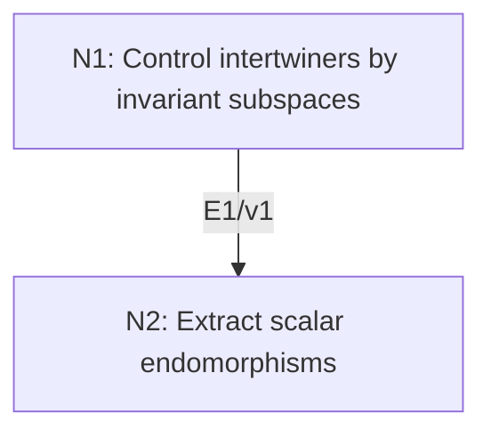

# Schur’s Lemma and Scalar Endomorphisms

## An End-to-End Metacognitive Mathematics Walkthrough

**Problem ID:** RT-02  
**Version:** 1  
**Subject:** Representation Theory and Lie Theory  
**Level:** Introductory  
**Status:** Complete authored exposition relative to the declared imports.  
**Evidence:** Mathematical argument and authored teaching traces; no actual multi-agent run, independent review, or proof-assistant certification is claimed.

## 1. Target, definitions, and import contract

Let $V,W$ be nonzero irreducible representations of a group $G$ over a field $k$. Every nonzero intertwiner $T:V\to W$ is an isomorphism. If $k$ is algebraically closed and $V$ is finite-dimensional, every equivariant endomorphism of $V$ is scalar. Consequently for finite-dimensional irreducibles over such $k$, $\dim_k\operatorname{Hom}_G(V,W)$ is one when $V\cong W$ and zero otherwise.

### Permitted imports and conventions

Use kernels and images of linear maps, eigenvalue existence for a linear operator on a nonzero finite-dimensional vector space over an algebraically closed field, and linear dimension. The first assertion does not require finite dimension or algebraic closure.

## 2. Intuition and node interaction workflow

Equivariance turns kernel and image into invariant subspaces. Algebraic closure then produces a scalar that makes an endomorphism singular, forcing it to vanish after subtraction.

Each mathematical node contains **Ego, Memory, Intellect, Sense, and Action**. The diagram records accepted proof dependencies. Requests to repair an argument belong only to §6; they are not backward proof edges.

### Evidence transfer ledger

| Transfer | Producer and export | Receiving activity | Exact claim and compatibility |
|---|---|---|---|
| T1-2 | N1/v1 · E1/v1 | N2.1 | Every nonzero $G$-intertwiner $T:V\to W$ is an equivariant isomorphism. Inputs in N2 retain the producer's assumptions; evidence: §4.N1. |

## 3. Node roles and five-faculty contracts

### N1/v1 — Control intertwiners by invariant subspaces

**Object and inputs:** $T\rho_V(g)=\rho_W(g)T$ for every $g$, and irreducible $V,W$.

**Role and strategy:** Apply irreducibility separately to the kernel and image.

**Local obligation:** Every nonzero $G$-intertwiner $T:V\to W$ is an equivariant isomorphism.

| Faculty | Concrete responsibility |
|---|---|
| Ego | Publish E1/v1 only with its stated domain and assumptions: Every nonzero $G$-intertwiner $T:V\to W$ is an equivariant isomorphism. |
| Memory | $T\rho_V(g)=\rho_W(g)T$ for every $g$, and irreducible $V,W$. Preserve the §1 conventions and incoming export versions. |
| Intellect | Apply irreducibility separately to the kernel and image. |
| Sense | Nonzero $T$ excludes the full kernel and zero image; check both injectivity and surjectivity. |
| Action | Execute activities N1.1–N1.2 in §4.N1; preserve the displayed calculations as evidence. |

**Export E1/v1:** Every nonzero $G$-intertwiner $T:V\to W$ is an equivariant isomorphism. Evidence: the complete local derivation in §4.N1.

**Acceptance gate:** Establish the local obligation through every numbered activity below and discharge this concrete check: Nonzero $T$ excludes the full kernel and zero image; check both injectivity and surjectivity.

**Targeted repair:** If only injectivity has been shown, use irreducibility of the codomain to establish surjectivity. Withhold E1 and its dependent exports until the correction has been checked; a revised export receives a new version.

### N2/v1 — Extract scalar endomorphisms

**Object and inputs:** E1/v1 and a finite-dimensional irreducible $V$ over algebraically closed $k$. Incoming proof exports: E1/v1 at N2.1.

**Role and strategy:** Subtract an eigenvalue, then apply the nonzero-isomorphism alternative.

**Local obligation:** $\operatorname{End}_G(V)=k\,\mathrm{id}$ and the stated Hom-space dimensions follow.

| Faculty | Concrete responsibility |
|---|---|
| Ego | Publish E2/v1 only with its stated domain and assumptions: $\operatorname{End}_G(V)=k\,\mathrm{id}$ and the stated Hom-space dimensions follow. |
| Memory | E1/v1 and a finite-dimensional irreducible $V$ over algebraically closed $k$. Preserve the §1 conventions and incoming export versions. |
| Intellect | Subtract an eigenvalue, then apply the nonzero-isomorphism alternative. |
| Sense | Eigenvalue existence is precisely where algebraic closure and finite dimension enter. |
| Action | Execute activities N2.1–N2.2 in §4.N2; preserve the displayed calculations as evidence. |

**Export E2/v1:** $\operatorname{End}_G(V)=k\,\mathrm{id}$ and the stated Hom-space dimensions follow. Evidence: the complete local derivation in §4.N2.

**Acceptance gate:** Establish the local obligation through every numbered activity below and discharge this concrete check: Eigenvalue existence is precisely where algebraic closure and finite dimension enter.

**Targeted repair:** If a real irreducible endomorphism is declared scalar, check whether it has a real eigenvalue; retain the algebraically closed field for this conclusion. Withhold E2 and its dependent exports until the correction has been checked; a revised export receives a new version.

## 4. Continuous mathematical proof

The following activities form one continuous proof. Intermediate claims are established where used, except for the explicitly permitted imports in §1.

### §4.N1 — Control intertwiners by invariant subspaces

1. **N1.1.** If $v\in\ker T$, then $T\rho_V(g)v=\rho_W(g)Tv=0$, so the kernel is invariant. The image is invariant because $\rho_W(g)Tv=T\rho_V(g)v$.

2. **N1.2.** Irreducibility gives $\ker T=0$ or $V$ and $\operatorname{im}T=0$ or $W$. Nonzero $T$ forces $\ker T=0$ and image $W$. Thus $T$ is a bijective linear map, and multiplying the intertwining equality by its inverse shows that the inverse is also equivariant.

### §4.N2 — Extract scalar endomorphisms

1. **N2.1.** For $A\in\operatorname{End}_G(V)$ choose an eigenvalue $\lambda\in k$. The map $A-\lambda I$ is equivariant and has a nonzero kernel. E1 says it cannot be a nonzero map, because then it would be invertible. Therefore $A=\lambda I$.

2. **N2.2.** If $V\not\cong W$, E1 rules out every nonzero intertwiner. If $S:V\to W$ is a fixed isomorphism, every intertwiner $T$ satisfies $S^{-1}T\in\operatorname{End}_G(V)$, so $T=\lambda S$. Thus the Hom-space is one-dimensional in the isomorphic case.

## 5. Worked instance and boundary audit

For the one-dimensional complex characters of $C_3$, let a generator act by $\omega$ on $V$ and by $\omega^2$ on $W$, where $\omega^3=1$ and $\omega\ne1$. A linear map is multiplication by $a$, and equivariance gives $a\omega=\omega^2a$, hence $a=0$. Each character’s endomorphism algebra is $\mathbb C$.

### Boundary or failed-inference witness

Over $\mathbb R$, let $C_4$ act on $\mathbb R^2$ by a rotation $J$ through $90$ degrees. There is no invariant real line, so the representation is irreducible. Yet $J$ commutes with the action and is not a real scalar matrix. The first part of Schur’s lemma holds; the scalar conclusion does not.

## 6. Illustrative interaction and repair trace

**Trace status:** Authored illustration, not a logged agent execution. The rejected candidate below is outside the accepted DAG.

**Rejected N2 export:** every endomorphism of a real irreducible representation is scalar. **Sense witness:** the rotation $J$. **Diagnosis:** Memory imported an eigenvalue over a field where none need exist. **Repair:** apply scalar Schur only over the algebraically closed field in §1. The broader real conclusion is replaced by the weaker statement that nonzero equivariant endomorphisms are invertible. The complex theorem is unchanged.

After the corrected argument is supplied, Ego may publish a hypothetical v2 export, Memory replaces the rejected version, and Action rechecks each descendant in §2. The accepted exposition in this file is v1; this scenario does not claim an actual revision or execution occurred.

## 7. Evidence ledger and reusable exports

| Item | Evidence and scope | Remaining limitation |
|---|---|---|
| Target theorem | §4, under exactly the §1 hypotheses and imports | Authored mathematical exposition; no independent or formal verification |
| E1–E2 | Local proofs §4.N1–§4.N2; version 1 | Imports remain attached to each reuse |
| Worked instance | Explicit computation or construction in §5 | Illustrates the mechanism; does not prove the universal theorem |
| Repair | Rejected inference, witness, and correction in §6 | Teaching scenario rather than empirical agent evidence |

**Reusable target:** Preserve `RT-02/v1`, the exact statement in §1, its assumptions, and this proof when reusing the result.

**Next direction:** Use the Hom-space dimension in RT-03 to convert an averaging projection into character orthogonality.

## 8. Sources and navigation

The proof and faculty decomposition are authored for this collection. The following primary teaching sources support further study; exact imports are specified in §1.

[Etingof and collaborators, Introduction to Representation Theory](https://math.mit.edu/~etingof/reprbook.pdf), sections on representations, characters, and $\mathfrak{sl}_2$; [MIT Lie Groups and Lie Algebras I lecture notes](https://ocw.mit.edu/courses/18-745-lie-groups-and-lie-algebras-i-fall-2020/lists/lecture-notes/) for solvable Lie algebras.

**Local imported proof modules:** None. Supporting external results are specified in §1.

[Five-project subject index](problems.md) · [Project README](../README.md) · [Graduate subject outline](../../book/outline.md)
