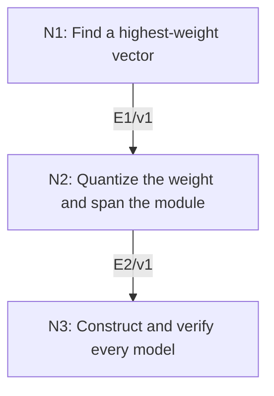

# Finite-Dimensional Irreducible Representations of sl2

## An End-to-End Metacognitive Mathematics Walkthrough

**Problem ID:** RT-05  
**Version:** 1  
**Subject:** Representation Theory and Lie Theory  
**Level:** Advanced  
**Status:** Complete authored exposition relative to the declared imports.  
**Evidence:** Mathematical argument and authored teaching traces; no actual multi-agent run, independent review, or proof-assistant certification is claimed.

## 1. Target, definitions, and import contract

Let $\mathfrak{sl}_2(\mathbb C)$ have generators $e,f,h$ satisfying $[h,e]=2e$, $[h,f]=-2f$, and $[e,f]=h$. Every nonzero finite-dimensional irreducible representation is, up to isomorphism, exactly one $V_n$ for an integer $n\ge0$. It has basis $v_0,\ldots,v_n$ with $hv_j=(n-2j)v_j$, $fv_j=v_{j+1}$ (and $fv_n=0$), and $ev_j=j(n-j+1)v_{j-1}$ (and $ev_0=0$). In particular $\dim V_n=n+1$.

### Permitted imports and conventions

Use eigenvalue existence over $\mathbb C$, linear independence of eigenvectors for distinct eigenvalues, the displayed Lie brackets, and polynomial interpolation on finitely many distinct scalars. Irreducibility is assumed for classification; this project does not prove that every finite-dimensional representation is completely reducible.

## 2. Intuition and node interaction workflow

Raising must eventually stop because it creates distinct weights. Lowering from a highest-weight vector then forces the highest weight to be a nonnegative integer.

Each mathematical node contains **Ego, Memory, Intellect, Sense, and Action**. The diagram records accepted proof dependencies. Requests to repair an argument belong only to §6; they are not backward proof edges.

### Evidence transfer ledger

| Transfer | Producer and export | Receiving activity | Exact claim and compatibility |
|---|---|---|---|
| T1-2 | N1/v1 · E1/v1 | N2.1 | There is $v_0\ne0$ with $ev_0=0$ and $hv_0=\lambda v_0$ for some $\lambda\in\mathbb C$. Inputs in N2 retain the producer's assumptions; evidence: §4.N1. |
| T2-3 | N2/v1 · E2/v1 | N3.3 | $\lambda=n\in\mathbb Z_{\ge0}$ and $v_0,\ldots,v_n$ form a basis of $V$ with the stated actions. Inputs in N3 retain the producer's assumptions; evidence: §4.N2. |

## 3. Node roles and five-faculty contracts

### N1/v1 — Find a highest-weight vector

**Object and inputs:** A nonzero finite-dimensional representation $V$.

**Role and strategy:** Start with an $h$-eigenvector and raise it until the last nonzero term.

**Local obligation:** There is $v_0\ne0$ with $ev_0=0$ and $hv_0=\lambda v_0$ for some $\lambda\in\mathbb C$.

| Faculty | Concrete responsibility |
|---|---|
| Ego | Publish E1/v1 only with its stated domain and assumptions: There is $v_0\ne0$ with $ev_0=0$ and $hv_0=\lambda v_0$ for some $\lambda\in\mathbb C$. |
| Memory | A nonzero finite-dimensional representation $V$. Preserve the §1 conventions and incoming export versions. |
| Intellect | Start with an $h$-eigenvector and raise it until the last nonzero term. |
| Sense | The raising chain has distinct weights; finite-dimensionality, not a preassumed diagonalization of all of $h$, forces termination. |
| Action | Execute activities N1.1–N1.2 in §4.N1; preserve the displayed calculations as evidence. |

**Export E1/v1:** There is $v_0\ne0$ with $ev_0=0$ and $hv_0=\lambda v_0$ for some $\lambda\in\mathbb C$. Evidence: the complete local derivation in §4.N1.

**Acceptance gate:** Establish the local obligation through every numbered activity below and discharge this concrete check: The raising chain has distinct weights; finite-dimensionality, not a preassumed diagonalization of all of $h$, forces termination.

**Targeted repair:** If $h$ is declared diagonalizable at the outset, replace that unproved claim by one eigenvector and the finite raising chain. Withhold E1 and its dependent exports until the correction has been checked; a revised export receives a new version.

### N2/v1 — Quantize the weight and span the module

**Object and inputs:** E1/v1 and irreducibility of $V$; write $v_j=f^jv_0$. Incoming proof exports: E1/v1 at N2.1.

**Role and strategy:** Commute $e$ through powers of $f$ and inspect the first vanishing lowered vector.

**Local obligation:** $\lambda=n\in\mathbb Z_{\ge0}$ and $v_0,\ldots,v_n$ form a basis of $V$ with the stated actions.

| Faculty | Concrete responsibility |
|---|---|
| Ego | Publish E2/v1 only with its stated domain and assumptions: $\lambda=n\in\mathbb Z_{\ge0}$ and $v_0,\ldots,v_n$ form a basis of $V$ with the stated actions. |
| Memory | E1/v1 and irreducibility of $V$; write $v_j=f^jv_0$. Preserve the §1 conventions and incoming export versions. |
| Intellect | Commute $e$ through powers of $f$ and inspect the first vanishing lowered vector. |
| Sense | The coefficient equation at $v_{n+1}=0$ uses $v_n\ne0$ and characteristic zero. |
| Action | Execute activities N2.1–N2.3 in §4.N2; preserve the displayed calculations as evidence. |

**Export E2/v1:** $\lambda=n\in\mathbb Z_{\ge0}$ and $v_0,\ldots,v_n$ form a basis of $V$ with the stated actions. Evidence: the complete local derivation in §4.N2.

**Acceptance gate:** Establish the local obligation through every numbered activity below and discharge this concrete check: The coefficient equation at $v_{n+1}=0$ uses $v_n\ne0$ and characteristic zero.

**Targeted repair:** If termination of lowering is asserted without justification, use the distinct eigenvalues; then apply the formula at the first zero, not merely at $v_n$. Withhold E2 and its dependent exports until the correction has been checked; a revised export receives a new version.

### N3/v1 — Construct and verify every model

**Object and inputs:** An arbitrary integer $n\ge0$ and the formulas in the theorem. Incoming proof exports: E2/v1 at N3.3.

**Role and strategy:** Check the brackets directly and recover the highest vector from any nonzero invariant subspace.

**Local obligation:** For each $n$, $V_n$ exists and is irreducible; these exhaust all isomorphism classes without duplication.

| Faculty | Concrete responsibility |
|---|---|
| Ego | Publish E3/v1 only with its stated domain and assumptions: For each $n$, $V_n$ exists and is irreducible; these exhaust all isomorphism classes without duplication. |
| Memory | An arbitrary integer $n\ge0$ and the formulas in the theorem. Preserve the §1 conventions and incoming export versions. |
| Intellect | Check the brackets directly and recover the highest vector from any nonzero invariant subspace. |
| Sense | Existence and irreducibility of the proposed models must be established in addition to the classification of a given module. |
| Action | Execute activities N3.1–N3.3 in §4.N3; preserve the displayed calculations as evidence. |

**Export E3/v1:** For each $n$, $V_n$ exists and is irreducible; these exhaust all isomorphism classes without duplication. Evidence: the complete local derivation in §4.N3.

**Acceptance gate:** Establish the local obligation through every numbered activity below and discharge this concrete check: Existence and irreducibility of the proposed models must be established in addition to the classification of a given module.

**Targeted repair:** If only the possible highest weights have been listed, add bracket verification and the invariant-subspace argument to establish that every listed model really exists and is irreducible. Withhold E3 and its dependent exports until the correction has been checked; a revised export receives a new version.

## 4. Continuous mathematical proof

The following activities form one continuous proof. Intermediate claims are established where used, except for the explicitly permitted imports in §1.

### §4.N1 — Find a highest-weight vector

1. **N1.1.** Choose $w\ne0$ with $hw=\alpha w$. The relation $he=eh+2e$ gives $h(e^jw)=(\alpha+2j)e^jw$ by induction. Nonzero members of this sequence are eigenvectors with distinct eigenvalues and hence linearly independent.

2. **N1.2.** They cannot all be nonzero in finite dimension. Choose the last nonzero one before the first zero, and name it $v_0$. It is killed by $e$ and has an $h$-eigenvalue $\lambda$, as required.

### §4.N2 — Quantize the weight and span the module

1. **N2.1.** Inductively, $hv_j=(\lambda-2j)v_j$. Also $ev_0=0$ and $ev_{j+1}=efv_j=fev_j+hv_j$, so induction gives $ev_j=j(\lambda-j+1)v_{j-1}$. These identities use only the brackets and remain true until and including the first zero vector.

2. **N2.2.** The nonzero lowered vectors have distinct weights, so finite dimension gives a largest $n$ with $v_n\ne0$ and $v_{n+1}=0$. Applying the formula at $n+1$ yields $0=(n+1)(\lambda-n)v_n$. Therefore $\lambda=n$.

3. **N2.3.** The span of $v_0,\ldots,v_n$ is invariant under $e,f,h$ by these formulas and is nonzero. Irreducibility forces it to equal $V$. Distinct weights give linear independence, so these vectors are a basis and all claimed coefficients follow.

### §4.N3 — Construct and verify every model

1. **N3.1.** Define three linear maps on the abstract basis by the stated formulas. The weight differences give $[h,e]=2e$ and $[h,f]=-2f$. Direct subtraction gives $[e,f]v_j=((j+1)(n-j)-j(n-j+1))v_j=(n-2j)v_j=hv_j$, with the same result at $j=0,n$ using zero boundary terms. Thus they define a representation.

2. **N3.2.** Let $U$ be a nonzero invariant subspace. A nonzero vector of $U$ has a nonzero component along some $v_j$. Because the $h$-eigenvalues are distinct, a polynomial in $h$ that equals one at that weight and zero at the other weights extracts a nonzero multiple of $v_j$ within $U$. Applying $e^j$ gives a nonzero multiple of $v_0$, since all coefficients $r(n-r+1)$ for $1\le r\le j$ are nonzero. Repeated $f$ then yields every basis vector. Hence $U=V_n$.

3. **N3.3.** N2 identifies any irreducible module with its corresponding model by sending the displayed basis to the abstract one. Different $n$ give different dimensions, so the models are pairwise nonisomorphic. This proves existence, uniqueness, and exhaustion.

## 5. Worked instance and boundary audit

For $n=2$, the weights are $2,0,-2$. The lowering chain is $v_0\mapsto v_1\mapsto v_2\mapsto0$, and $ev_1=2v_0$, $ev_2=2v_1$. At the middle vector, $efv_1=2v_1$ and $fev_1=2v_1$, so their difference equals $hv_1=0$. At $v_0$, the difference is $2v_0=hv_0$.

### Boundary or failed-inference witness

Irreducibility is essential for the conclusion that one chain spans the entire module. The direct sum $V_0\oplus V_0$ has dimension two but $h=e=f=0$; it is not the irreducible $V_1$, whose $h$ weights are $1,-1$.

## 6. Illustrative interaction and repair trace

**Trace status:** Authored illustration, not a logged agent execution. The rejected candidate below is outside the accepted DAG.

**Rejected N2 conclusion:** a highest-weight chain spans every finite-dimensional representation. **Sense witness:** $V_0\oplus V_0$, where any generated chain is just one line. **Diagnosis:** the passage from a nonzero invariant span to all of $V$ silently used irreducibility. **Repair:** invoke the stated irreducibility hypothesis precisely at N2.3. No general complete-reducibility claim is added; recheck the basis and dimension exports.

After the corrected argument is supplied, Ego may publish a hypothetical v2 export, Memory replaces the rejected version, and Action rechecks each descendant in §2. The accepted exposition in this file is v1; this scenario does not claim an actual revision or execution occurred.

## 7. Evidence ledger and reusable exports

| Item | Evidence and scope | Remaining limitation |
|---|---|---|
| Target theorem | §4, under exactly the §1 hypotheses and imports | Authored mathematical exposition; no independent or formal verification |
| E1–E3 | Local proofs §4.N1–§4.N3; version 1 | Imports remain attached to each reuse |
| Worked instance | Explicit computation or construction in §5 | Illustrates the mechanism; does not prove the universal theorem |
| Repair | Rejected inference, witness, and correction in §6 | Teaching scenario rather than empirical agent evidence |

**Reusable target:** Preserve `RT-05/v1`, the exact statement in §1, its assumptions, and this proof when reusing the result.

**Next direction:** Develop the separate complete-reducibility theorem and then tensor-product decomposition rules, keeping them distinct from this irreducible classification.

## 8. Sources and navigation

The proof and faculty decomposition are authored for this collection. The following primary teaching sources support further study; exact imports are specified in §1.

[Etingof and collaborators, Introduction to Representation Theory](https://math.mit.edu/~etingof/reprbook.pdf), sections on representations, characters, and $\mathfrak{sl}_2$; [MIT Lie Groups and Lie Algebras I lecture notes](https://ocw.mit.edu/courses/18-745-lie-groups-and-lie-algebras-i-fall-2020/lists/lecture-notes/) for solvable Lie algebras.

**Local imported proof modules:** None. Supporting external results are specified in §1.

[Five-project subject index](problems.md) · [Project README](../README.md) · [Graduate subject outline](../../book/outline.md)
