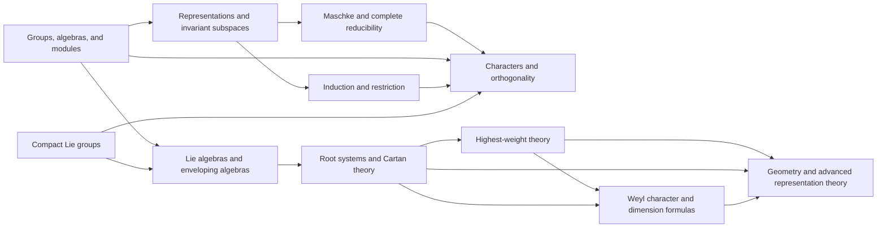

# Meta-Graph: Representation Theory and Lie Theory

> **Purpose.** This is a subject-level dependency map for planning a future theorem knowledge graph. It shows a representative route through the field; it is not a complete list of prerequisites, a formal proof dependency database, or a claim that every course follows this order.

## How to read this graph

- **Nodes** are foundational ideas, methods, structural results, or major theorems. A node may later expand into its own proof-level graph.
- An arrow `X → Y` means that X commonly supplies language, a method, a hypothesis, or a result used in understanding or proving Y. The edge table says which role it plays.
- Some edges describe a common proof route or conceptual bridge rather than a logically necessary dependency. The eventual theorem graph should record the exact theorem, hypotheses, source, and proof step for every strict dependency.
- The graph is a DAG at this global overview level. Feedback and revision belong inside proof workflows; they should not be mistaken for a theorem depending on itself.

## Global subject map

## Node register

| ID | Idea, theorem, or method | Role in the subject |
|---|---|---|
| A | Groups, algebras, and modules | Supply the objects whose actions are represented |
| B | Representations and invariant subspaces | Convert symmetry into linear maps |
| C | Maschke and complete reducibility | Decompose finite-group representations under characteristic conditions |
| D | Characters and orthogonality | Encode representations by trace functions |
| E | Induction and restriction | Relate representations across subgroups |
| F | Lie algebras and enveloping algebras | Linearize continuous symmetry and build modules |
| G | Root systems and Cartan theory | Classify semisimple Lie algebras and their structure |
| H | Highest-weight theory | Classify finite-dimensional irreducible modules |
| I | Compact Lie groups | Connect Lie groups, Haar integration, and representation theory |
| J | Weyl character and dimension formulas | Compute characters and dimensions from roots |
| K | Geometry and advanced representation theory | Connect flag varieties, cohomology, and modern theories |

## Dependency register

| From → To | Connection type | How the earlier node supports the later node |
|---|---|---|
| A → B (Groups, algebras, and modules → Representations and invariant subspaces) | Common mathematical dependency | A representation is an algebra/module action. |
| B → C (Representations and invariant subspaces → Maschke and complete reducibility) | Common mathematical dependency | Invariant complements yield decomposition. |
| C → D (Maschke and complete reducibility → Characters and orthogonality) | Common mathematical dependency | Irreducible summands are encoded by characters. |
| A → D (Groups, algebras, and modules → Characters and orthogonality) | Common mathematical dependency | Trace is defined directly from representation matrices. |
| B → E (Representations and invariant subspaces → Induction and restriction) | Common mathematical dependency | Subspaces and induced modules support restriction/induction. |
| E → D (Induction and restriction → Characters and orthogonality) | Common mathematical dependency | Induction formulas transform character data. |
| A → F (Groups, algebras, and modules → Lie algebras and enveloping algebras) | Common mathematical dependency | Lie algebras act through enveloping algebra modules. |
| F → G (Lie algebras and enveloping algebras → Root systems and Cartan theory) | Common mathematical dependency | Root decomposition organizes semisimple structure. |
| G → H (Root systems and Cartan theory → Highest-weight theory) | Common mathematical dependency | Positive roots and weights define highest-weight modules. |
| H → J (Highest-weight theory → Weyl character and dimension formulas) | Common mathematical dependency | Highest weights determine character and dimension formulas. |
| I → F (Compact Lie groups → Lie algebras and enveloping algebras) | Common mathematical dependency | Differentiation relates Lie group representations to Lie algebra representations. |
| I → D (Compact Lie groups → Characters and orthogonality) | Common mathematical dependency | Haar integration yields character orthogonality. |
| G → J (Root systems and Cartan theory → Weyl character and dimension formulas) | Common mathematical dependency | Weyl group and roots determine formulas. |
| H → K (Highest-weight theory → Geometry and advanced representation theory) | Common mathematical dependency | Highest-weight modules connect to geometry and categorification. |
| G → K (Root systems and Cartan theory → Geometry and advanced representation theory) | Common mathematical dependency | Flag varieties encode root data geometrically. |
| J → K (Weyl character and dimension formulas → Geometry and advanced representation theory) | Common mathematical dependency | Character formulas support deeper structural applications. |

## Suggested reading paths

**Core route:** follow the nodes from foundational language toward the central structural theorems, then continue to the advanced endpoint. For a first pass, read the graph left to right and pause at each node to state its hypotheses and output.

**Theorem-focused route:** choose a major theorem node, trace incoming arrows backward to identify imported results, then trace outgoing arrows to see what the theorem enables. Mark which incoming edges are strict dependencies after consulting a proof-level source.

**Bridge route:** follow cross-links between methods and neighboring theories. Treat these as transfer routes: identify exactly what is preserved, what hypotheses are added, and what changes under translation.

## Five-component expansion for each theorem node

When a node is selected for a complete Meta-Math walkthrough, preserve the node ID and expand it into a local five-component proof graph:

| Component | Local responsibility |
|---|---|
| **Contract** | State the precise theorem goal, scope, and proof contract; distinguish the claim from nearby stronger or weaker claims. |
| **Knowledge** | Retrieve definitions, hypotheses, lemmas, source references, and known examples/counterexamples required by this node. |
| **Strategy** | Select and order proof steps; justify each inference and expose dependency on incoming nodes. |
| **Validation** | Check type/notation consistency, hypothesis use, boundary cases, examples, and whether each intermediate claim is actually supported. |
| **Execution** | Execute proof steps, calculations, constructions, or formal checks; emit the verified result and update outgoing dependencies. |

A later graph version should connect global theorem nodes to these local component nodes, with typed edges such as `uses`, `specializes`, `generalizes`, `contradicts`, `analogy-only`, and `verified-by`.

## Expansion record

For each node promoted from this map, add a stable theorem or concept ID, exact statement, source and page/section, prerequisite IDs, proof-step graph, explicit hypothesis checks, known failure modes, examples, and verification status. Keep conjectural or analogy-only links visually distinct from proved dependencies.

**Related syllabus:** [`outline.md`](book-outline.md).
